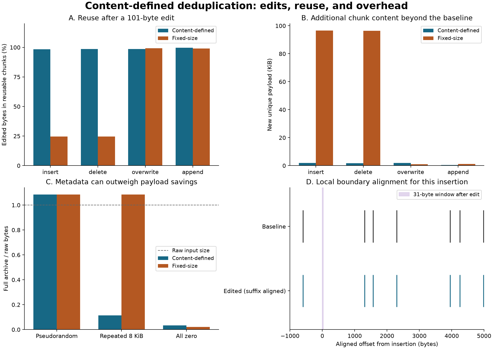

# Rolling chunk deduplication

A small content-defined chunker and bounded deduplicating archive, with exact reconstruction tests and reproducible byte-level edit experiments. It separates three questions: **where to cut**, **which content is identical**, and **whether a saved archive is internally consistent**.

The core uses only Python's standard library. All experiments use explicitly synthetic bytes. This is an in-memory engineering demonstration, not a production backup or encrypted storage system.

## Reproduce

Python 3.11 or 3.13:

```bash
python3 -m venv .venv
source .venv/bin/activate
python -m pip install -r requirements-repro.txt
python -m pip install --no-deps .
python -m pip check
python -m pytest -q
python examples/run_demo.py --output results
python examples/cli_roundtrip.py
```

Matplotlib and NumPy are used only for plotting; pytest is for tests. Dependency pins are in `requirements-repro.txt`. The workflow tests the installed package and both examples on Python 3.11 and 3.13. The command-line roundtrip uses generated files in a temporary directory and compares the restored bytes exactly.

## Chunk boundaries

The content-defined mode computes a 64-bit Buzhash fingerprint over the last 31 bytes. A public, deterministic 256-entry table is derived from SHA-256 of `b'rolling-chunk-dedup-v1:' + bytes([byte])`, taking its first eight bytes as a big-endian integer. This table is part of format version 1, not a secret.

For a full window, the constant-work update rotates the prior fingerprint one bit, XORs in the incoming byte's table value, and XORs out the outgoing byte's table value rotated by 31 bits. The first 30 positions use the available prefix. Tests independently recompute each fingerprint from every byte contribution without the rolling recurrence.

Default boundary rules:

- Minimum chunk length: 256 bytes.
- Cut when the lowest 10 fingerprint bits are zero, after the minimum.
- Force a cut at 4096 bytes.
- Emit any nonempty final remainder, even if shorter than the minimum.

The rolling window is **not reset at cuts**; only chunk age is reset. A fixed-size baseline is also provided. `2^mask_bits` is a nominal mask interval under an idealized hash model, **not a promised mean chunk size**. Minimum/maximum rules, correlated windows, repeated content, and low-entropy bytes change the observed distribution.

After an insertion, rolling fingerprints for aligned unchanged suffix windows agree once the changed bytes leave the 31-byte window. This is a local fingerprint identity, not a guarantee that all chunk boundaries realign: minimum-age gates and forced maximum cuts also depend on the preceding cut. The demo records actual boundaries rather than assuming resynchronization.

## Deduplication and archive format

Buzhash decides cuts only. Full chunks are identified with SHA-256. During packing, a repeated digest is merged only after the stored and incoming bytes are compared; unequal bytes with the same digest cause an error. A collision test deliberately replaces the digest function to check this path.

An archive stores 1–32 ordered byte strings without filenames or filesystem metadata. Its format is:

1. Eight magic bytes `RCDUP1\r\n`.
2. Four-byte unsigned big-endian manifest length.
3. JSON manifest: format version, chunker settings, unique chunk sizes/digests, and each entry's size/digest/ordered chunk indices.
4. Unique chunk payloads concatenated in the manifest's order.

The packer emits compact sorted-key JSON and stores unique chunks in first-use order, so the same inputs/settings produce identical archive bytes. The decoder accepts equivalent valid JSON layouts; it does not require canonical metadata encoding or first-use table order.

Both `unpack` and `inspect_archive` fully validate the archive before returning:

- Header, size bounds, schema, duplicate keys, field types, and supported parameters.
- Every chunk's length and SHA-256; no duplicate chunk IDs or trailing bytes.
- Entry reference ranges, total size, reconstructed entry digest, and absence of unused chunks.
- Recomputed chunk boundaries under the declared settings.

The total decoded size is checked before joining referenced chunks, preventing a small reference list from demanding unbounded expansion. Metadata and payload are both bounded. Inspection is deliberately **not** a cheap metadata-only operation: it reads, hashes, reconstructs, and rechunks all entries.

Checksums provide consistency checks, **not authentication**. An attacker able to rewrite the data and manifest can create a different valid archive. There is no encryption, MAC, signature, secret chunking seed, or confidentiality guarantee. SHA-256 collision resistance is assumed when validating untrusted stored data; byte comparison adds a concrete check during packing but does not turn a hash into a proof of authenticity.

## Experiments and accounting



The base is 128 KiB of deterministic pseudorandom bytes from `random.Random(20261110)`. Four separate 101-byte edits are applied: insertion, deletion, overwrite at offset 32768, and append. Each comparison packs the baseline and edited version together, then checks exact reconstruction. The fixed block size is chosen to approximately match the content-defined baseline's observed chunk count. Both actual configurations and chunk counts are reported.

Reuse is measured by **exact byte equality** with any baseline chunk. The reusable byte count includes every matching chunk occurrence in the edited version. New payload is the total size of distinct edited chunks whose contents were absent from the baseline. These are different quantities when chunks repeat.

Three one-entry corpora expose storage tradeoffs: pseudorandom bytes, an 8 KiB pseudorandom block repeated sixteen times, and all-zero bytes. Reports distinguish:

- Raw bytes across entries.
- Unique stored payload bytes, without compression.
- Header/manifest overhead.
- Total archive bytes, which can exceed raw size.

Recorded results use 118 baseline chunks for both methods; the matched fixed size is 1111 bytes:

| Quantity | Content-defined | Fixed-size (1111 bytes) |
|:--|--:|--:|
| Reusable edited bytes after insertion | 129,167 / 131,173 (98.47%) | 32,219 / 131,173 (24.56%) |
| New unique payload after insertion | 2,006 bytes | 98,954 bytes |
| New unique payload after overwrite | 1,905 bytes | 1,111 bytes |
| Full archive: pseudorandom input | 142,217 bytes | 142,293 bytes |
| Full archive: repeated 8 KiB block | 15,077 bytes | 142,293 bytes |
| Full archive: all-zero input | 4,491 bytes | 2,851 bytes |

The content-defined method helps with this insertion and deletion, while the fixed method needs fewer new bytes for the overwrite and less total storage for all-zero data. Both grow the pseudorandom input by about 8.5% after metadata. All-zero content hits the 4096-byte maximum on every content-defined cut here, illustrating why the nominal 1024-byte mask interval is not an average-size guarantee.

The repeated-block comparison is also parameter-sensitive: 1111-byte fixed blocks are not aligned with 8192-byte repetitions. A separate `aligned_fixed_8KiB_reference` in the JSON uses 8192-byte fixed blocks and stores that repeated payload only once. The matched-count comparison is one declared setting, not a claim that fixed-size chunking cannot exploit repetition.

`results/summary.json` contains exact byte counts, settings, chunk sizes, and roundtrip-validated archive accounting. `results/insertion_boundaries.json` records the baseline and edited cut positions. The boundary plot keeps prefix coordinates unchanged and shifts edited suffix coordinates back by the insertion length; cuts inside the inserted region, if any, are omitted from that alignment view. It is a local illustration for that particular edit. No timing benchmark, expected compression ratio, or universal improvement is claimed.

## API and command line

```python
from rolling_dedup import Config, pack, unpack, inspect_archive

versions = [b'abc' * 2000, b'abc' * 1000 + b'inserted' + b'abc' * 1000]
archive = pack(versions, Config())
assert unpack(archive) == versions
print(inspect_archive(archive))
```

```bash
rolling-dedup pack first.bin second.bin --output versions.rcd
rolling-dedup inspect versions.rcd
rolling-dedup unpack versions.rcd --entry 1 --output restored.bin
```

`--entry` is zero-based. Packing also accepts `--method fixed --fixed-size 1024`. The Python `Config` exposes minimum, maximum, mask bits, and fixed size. All fields are validated even if a selected method does not use them. Configurations are immutable.

Commands refuse to overwrite existing output paths. Input files are never modified, and invalid archives are rejected before any extraction output is created. File writes use exclusive creation but are not crash-atomic; an interrupted write can leave a partial new output that must be handled by the caller. Exit codes: 0 success, 1 data/file error, 2 command-line usage error.

Limits: 8 MiB combined raw input/output, 16 MiB archive, 4 MiB manifest, 32 entries, 65,536 total references, chunk sizes at most 65,536 bytes, minimum/fixed size at least 32, and 5–16 mask bits. Each limit applies independently; metadata or reference limits can reject an input below the raw-byte cap. This implementation holds input, chunks, metadata, and reconstructed results in memory, often with multiple copies. It is not a streaming API.

## Verification and limitations

The 59 tests cover rolling hashes against independent full-window recomputation, cuts against a naive reference, local edit invariance, exact reconstruction, deterministic encoding, duplicate content, deliberately colliding digests, truncation, altered payloads, reordered/out-of-range references, changed settings, output expansion, unused chunks, and CLI overwrite prevention.

Content-defined boundaries can be ineffective for some inputs, and forced cuts can preserve alignment problems. Deduplication is not compression: small inputs and unique content can grow after metadata is added. No filesystem tree traversal, file permissions, incremental store maintenance, garbage collection, crash recovery, network protocol, sparse-file handling, or production performance tuning is implemented. The synthetic corpus is a controlled example, not a representative workload study.

## References and provenance

The code, format, synthetic data, tests, and plots are written for this repository. No external dataset or private files are used.

- [Borg 1.x internals: chunking and deduplication](https://borgbackup.readthedocs.io/en/stable/internals/data-structures.html) documents Buzhash content-defined chunking and the distinction between boundary fingerprints and chunk identity. This repository has its own table, parameters, implementation, and incompatible archive format; it does not implement Borg.
- [Xia et al., FastCDC, USENIX ATC 2016](https://www.usenix.org/conference/atc16/technical-sessions/presentation/xia) provides background on content-defined chunking for deduplication. This project implements Buzhash, not FastCDC, and makes no comparison with that paper's throughput results.

MIT licensed; see `LICENSE`.
